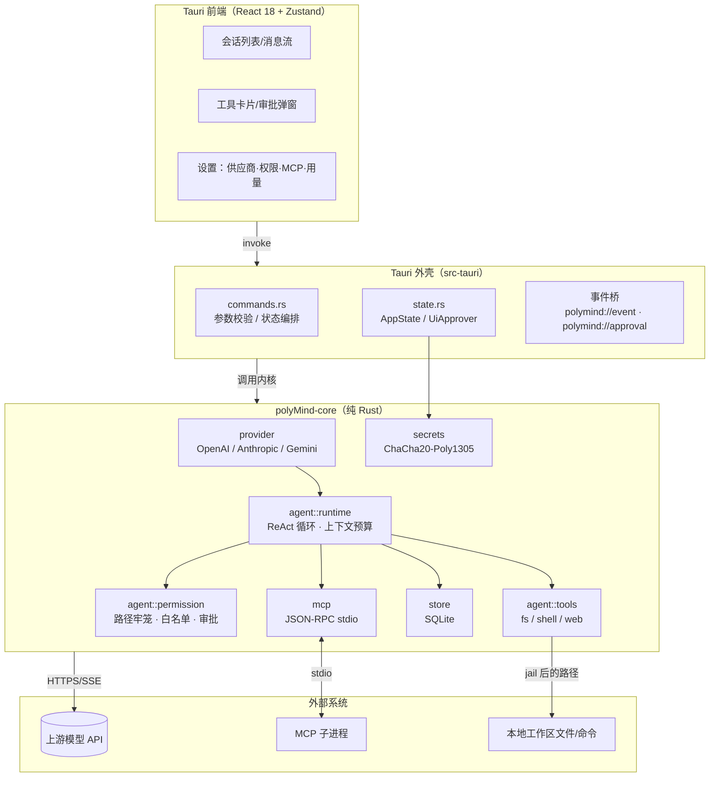
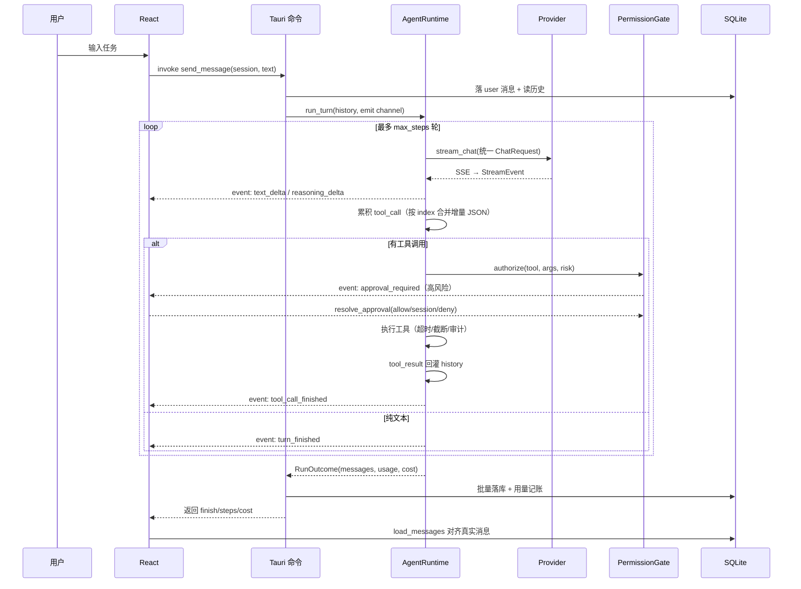

# PolyMind 架构设计

## 1. 总体结构



**分层原则**：

- 内核不认识 Tauri、不认识 React、不认识窗口。它只依赖 `tokio + reqwest + rusqlite`。
- 外壳只做三件事：参数校验、把内核事件转成前端事件、把用户点击转成内核调用的返回值。
- 前端不持有任何业务真相：消息以数据库为准，流式只是"预览态"。

## 2. 一次 turn 的时序



关键：**流式期间前端只做展示，结束后一律从数据库重载**，避免"界面和服务端两份真相"。

## 3. 模块职责

| 模块 | 文件 | 职责 | 不做什么 |
| --- | --- | --- | --- |
| 统一模型层 | `core/src/model.rs` | 消息/parts/usage/工具描述/计价 | 不碰网络 |
| SSE 解析 | `provider/mod.rs` | 字节流 → 帧 → 事件 | 不理解业务语义 |
| OpenAI 适配 | `provider/openai.rs` | 请求映射、tool_calls 增量合并、usage | 不做重试策略（由 runtime 决定） |
| Anthropic 适配 | `provider/anthropic.rs` | system 顶层、max_tokens、content block | 不改写消息顺序（只合并连续同角色） |
| Gemini 适配 | `provider/gemini.rs` | functionCall/Response、SSE 分块 | 不伪造 tool id（用 `gemini_{i}_{name}`） |
| 注册表 | `provider/registry.rs` | `provider/model` 解析、默认路由 | 不做负载均衡（V0.2） |
| Agent 循环 | `agent/runtime.rs` | 选模型→流式→工具→回灌→收口 | 不直接读写文件 |
| 权限门 | `agent/permission.rs` | 路径判定、命令白名单、审批等待 | 不改工具参数 |
| 工具 | `agent/tools/*` | 具体 IO 行为 + 风险声明 | 不决定是否允许（交给权限门） |
| MCP | `mcp/mod.rs` | 握手、tools/list、tools/call | 不缓存业务数据 |
| 存储 | `store/mod.rs` | 迁移、CRUD、聚合 | 不做加密（密钥在 secrets） |

## 4. 统一消息模型

```rust
enum ContentPart {
  Text { text },
  Image { mime, data_b64 },
  ToolUse { id, name, input },
  ToolResult { id, name, content, is_error },
}
```

设计原因：三家协议的差异主要在"工具调用放在哪、结果怎么回去"。

| 概念 | OpenAI | Anthropic | Gemini |
| --- | --- | --- | --- |
| 系统提示 | `messages[0].role=system` | 顶层 `system` | `systemInstruction` |
| 工具调用 | `assistant.tool_calls[]` | `content[].tool_use` | `parts[].functionCall` |
| 工具结果 | 独立 `role=tool` 消息 | user 消息里的 `tool_result` | user 的 `functionResponse` |
| 工具增量 | `function.arguments` 逐字拼接 | `input_json_delta.partial_json` | 一次性完整 `args` |
| 结束原因 | `finish_reason` | `stop_reason` | `finishReason` |

内核用一套 `ContentPart` 表示，适配器在边界完成翻译。**新增一家供应商 = 新增一个 `Provider` 实现 + 在 `registry` 里注册**，Agent 循环零改动。

## 5. 工具循环与状态机

```
ReadOnly:  Low ───────────────▶ 执行
           Medium/High ───────▶ 拒绝

Ask:       Low ───────────────▶ 执行
           Medium/High ──▶ 审批 ──allow──▶ 执行
                              ├─session──▶ 本会话同类放行
                              └─deny────▶ 回灌 "用户拒绝"

Auto:      Low/Medium ────────▶ 执行
           High ──────────────▶ 审批
```

- 风险等级由工具实现声明，**模型无法通过参数改变风险等级**。
- 审批超时（600s）与关闭弹窗都按拒绝处理。
- 每次工具调用写 `tool_audit`（工具名、参数、决策、是否成功、耗时）。

## 6. 上下文预算

`compact()` 的规则：

1. 估算 token（中文 1 字≈1 token，英文 4 字符≈1 token）；
2. 超预算时从最早开始丢，但保留最近 ≥6 条；
3. 丢弃后若首条是 `tool` 消息，继续丢到非 tool，防止出现"孤立的工具结果"（部分上游会 400）；
4. 插入一条 system 提示说明折叠了多少条，模型可主动重新读取文件。

V0.2 会改成"用便宜模型做摘要"，当前版本刻意选择确定性策略：**可预测、零成本、不会因为摘要再烧一次 token**。

## 7. 存储

```sql
sessions(id, title, model_ref, workspace, created_at, updated_at, archived)
messages(id, session_id, seq, role, payload(JSON), created_at)
usage_ledger(id, session_id, model_ref, input_tokens, output_tokens, cache_read_tokens, cost_usd, created_at)
tool_audit(id, session_id, tool, args, decision, ok, duration_ms, created_at)
```

- WAL 模式，单文件便于备份；
- 消息体存 JSON 整条，避免 schema 频繁迁移；
- 用量按 `model_ref` 聚合，跨供应商可比价；
- 删除会话级联清理消息与用量（审计表保留，便于事后追责）。

## 8. 密钥与配置

```
config.json  ── providers[].api_key_cipher ──▶  "v1:base64(nonce||ciphertext)"
secrets.key  ── 32 字节随机主密钥（首次生成，0600）
```

- 明文 `api_key` 字段 `#[serde(skip)]`，序列化时绝不落盘；
- 启动时解密到内存，重建 Registry；
- UI 只能拿到 `mask_key()` 的分号尾号。

V0.2：Windows 用 DPAPI 二次封装主密钥，macOS 用 Keychain，彻底避免"拷走 secrets.key"。

## 9. 失败模式与降级

| 失败 | 行为 | 用户感知 |
| --- | --- | --- |
| 主模型 401/403 | 不重试，直接报鉴权错误 | "auth: 鉴权失败" + 去设置改 Key |
| 429 / 5xx | 退避重试 1 次，失败则切兜底模型 | 顶部提示"已切换到 xxx" |
| 流中断 | 保留已生成文本，标记本轮未完成 | 消息仍在，可重发 |
| 工具超时 | kill 进程，回灌"超时"错误 | Agent 自行调整策略 |
| MCP 启动失败 | 记录到 `mcp.errors`，主流程照常 | MCP 面板红点 |
| 数据库锁 | 短重试，仍失败则内存态继续 | 日志告警 |

## 10. 性能预算

| 环节 | 预算 | 手段 |
| --- | --- | --- |
| 冷启动 | 3s | 懒启动 MCP；Registry 只解析不预拉模型 |
| 首 token | 1.5s（不含模型） | 请求体最小化；不做前置摘要 |
| 单轮工具 | 180s 上限 | 命令单独 60s 默认，可调 |
| 内存 | <120MB 空会话 | 消息分页加载（V0.2）；工具输出 6k 截断 |
| SSE 解析 | 1MB/s 无压力 | 手动按帧切分，避免正则 |

## 11. 扩展点

**新增供应商**：实现 `Provider::stream_chat` + `pricing` + `info`，在 `Registry::from_configs` 加一个分支。

**新增内置工具**：实现 `Tool`（`spec/risk/reason/call`），在 `ToolRegistry::builtin()` 注册。工具必须自己声明风险，默认 `High`。

**接入 MCP**：设置里填 `command + args`，内核自动握手、拉工具、加前缀注册。无需改代码。

**换前端**：`core` 是独立 crate，CLI 已经证明可以脱离 Tauri 复用；后续可接 Web（Axum）或 IM 机器人。
